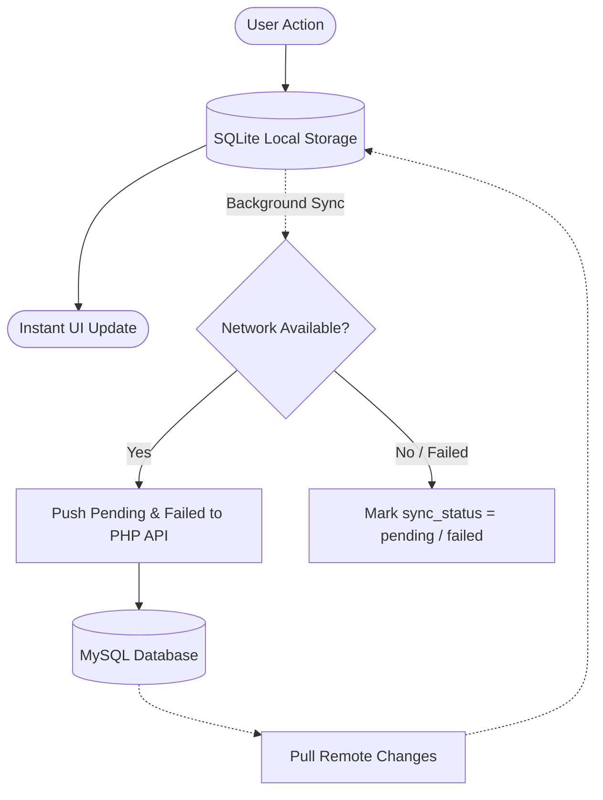

# Expense Tracker Pro 💰📱

A modern, full-featured cross-platform expense tracking application built with **Flutter**, featuring an **offline-first** architecture with SQLite, background two-way synchronization to a **PHP REST API** backend with **MySQL**, and secure authentication via **Firebase & Google Sign-In**.

---

## ✨ Key Features

- 📶 **Offline-First Architecture**: 
  - Log, edit, and organize expenses without an internet connection using local SQLite.
  - Automatic two-way background sync whenever internet connectivity is restored.
  - Status indicators for pending, failed, or synced records.
- 🔐 **Secure Authentication**:
  - Firebase Authentication with Google Sign-In support.
  - Bearer token-authenticated REST API endpoints validated by PHP backend middleware.
- 🏷️ **Categories & Tags**:
  - Organize your spending into intuitive categories (Food, Transport, Bills, etc.).
  - Multi-tag support for fine-grained labeling and fast filtering.
- 📊 **Budget & Analytics**:
  - Monthly budget tracking with progress indicators and threshold warnings.
  - Visual charts and summaries powered by `fl_chart`.
- 🎨 **Modern UI & Themes**:
  - Clean Material 3 design system.
  - Light & Dark mode support with persistent user preferences (`SharedPreferences`).
- 💻 **Cross-Platform Support**:
  - Runs on **Android**, **iOS**, **Web**, and **Desktop** (Windows & Linux via SQLite FFI).

---

## 🛠️ Tech Stack

### Frontend (Flutter)
- **Framework**: [Flutter](https://flutter.dev/) (Dart SDK `^3.11.4`)
- **State Management**: [Provider](https://pub.dev/packages/provider)
- **Local Storage**: [sqflite](https://pub.dev/packages/sqflite) (Mobile) & [sqflite_common_ffi](https://pub.dev/packages/sqflite_common_ffi) (Desktop)
- **Preferences**: [shared_preferences](https://pub.dev/packages/shared_preferences)
- **Charts & Visualization**: [fl_chart](https://pub.dev/packages/fl_chart)
- **Authentication**: [firebase_auth](https://pub.dev/packages/firebase_auth) & [google_sign_in](https://pub.dev/packages/google_sign_in)
- **Networking**: [http](https://pub.dev/packages/http)
- **Localization**: [intl](https://pub.dev/packages/intl) (`id_ID`)

### Backend (PHP API)
- **Language**: PHP 8.x
- **Database**: MySQL (`PDO_MySQL`)
- **Auth Middleware**: Firebase ID Token JWT validation & verification
- **Router**: Lightweight PHP built-in server router (`backend/router.php`)

---

## 📁 Project Structure

```text
expense_tracker_pro/
├── android/                   # Android native configuration
├── ios/                       # iOS native configuration
├── web/                       # Web platform assets & configuration
├── windows/                   # Windows desktop platform runner
├── linux/                     # Linux desktop platform runner
├── backend/                   # PHP REST API backend
│   ├── auth_middleware.php    # Firebase ID token validation middleware
│   ├── config.php             # Database credentials & PDO connection
│   ├── expenses.php           # CRUD endpoints for expenses
│   ├── router.php             # Local server routing & CORS handling
│   └── setup_db.php           # Database schema migration script
├── lib/                       # Flutter application source code
│   ├── database/              # SQLite database initialization & migrations
│   ├── models/                # Data models (Expense, Category, Tag)
│   ├── providers/             # State management (ExpenseProvider, ThemeProvider)
│   ├── screens/               # Application views
│   │   ├── home_screen.dart
│   │   ├── login_screen.dart
│   │   ├── expense_form_screen.dart
│   │   ├── category_screen.dart
│   │   ├── tag_screen.dart
│   │   └── settings_screen.dart
│   ├── services/              # API, Auth, SQLite, and Shared Preferences services
│   ├── theme/                 # AppTheme (colors, light/dark themes)
│   ├── widgets/               # Reusable UI widgets (cards, chips)
│   └── main.dart              # App entrypoint
├── pubspec.yaml               # Flutter package configuration & dependencies
└── README.md                  # Project documentation
```

---

## 🚀 Getting Started

### Prerequisites

1. **Flutter SDK**: Ensure Flutter is installed (`flutter --version`).
2. **PHP 8+ & MySQL**: (e.g., via XAMPP, Laragon, Docker, or native services).
3. **Android Studio / Chrome / VS Code**: Depending on your target platform.

---

### Step 1: Set Up Backend Database & API

1. Start your MySQL service.
2. Configure database credentials in [`backend/config.php`](backend/config.php) if your local MySQL settings differ from default:
   ```php
   $host = '127.0.0.1';
   $db   = 'expense_tracker_db';
   $user = 'root';
   $pass = '';
   ```
3. Initialize the database and table schema:
   ```bash
   php backend/setup_db.php
   ```
4. Start the local PHP development server:
   ```bash
   php -S 127.0.0.1:58348 backend/router.php
   ```
   > **Note for Android Emulator**: The Flutter app automatically routes requests to `10.0.2.2:58348` when running inside the standard Android emulator.

---

### Step 2: Set Up and Run the Flutter App

1. **Clone the repository**:
   ```bash
   git clone https://github.com/relfnot/expense-tracker-pro.git
   cd expense-tracker-pro
   ```

2. **Install Flutter dependencies**:
   ```bash
   flutter pub get
   ```

3. **Run on your desired target**:
   - **Chrome (Web)**:
     ```bash
     flutter run -d chrome
     ```
   - **Android Emulator / Device**:
     ```bash
     flutter run -d android
     ```
   - **Windows Desktop**:
     ```bash
     flutter run -d windows
     ```

---

## 📡 API Overview

All API requests require a Firebase Bearer token in the `Authorization` header:

```http
Authorization: Bearer <FIREBASE_ID_TOKEN>
Content-Type: application/json
```

| Method | Endpoint | Description |
| :--- | :--- | :--- |
| `GET` | `/expenses` | Retrieve all expenses for the authenticated user |
| `POST` | `/expenses` | Create a new expense |
| `PUT` | `/expenses/{id}` | Update an existing expense |
| `DELETE` | `/expenses/{id}` | Delete an expense |

---

## 🔄 Offline & Synchronization Flow



1. **Instant Write**: When an expense is created, edited, or deleted, changes are committed to the local SQLite database immediately for zero latency.
2. **Queueing**: If offline or if the backend request fails, the record is flagged as `pending` or `failed`.
3. **Background Sync**: On startup or network reconnection, unsynced records are uploaded to the PHP server, and local caches are reconciled with the server.

---

## 🤝 Contributing

Contributions, issues, and feature requests are welcome!
Feel free to open an issue or submit a pull request.

1. Fork the Project
2. Create your Feature Branch (`git checkout -b feature/AmazingFeature`)
3. Commit your Changes (`git commit -m 'Add some AmazingFeature'`)
4. Push to the Branch (`git push origin feature/AmazingFeature`)
5. Open a Pull Request

---

## 📄 License

This project is licensed under the [MIT License](LICENSE) (or your preferred license).
